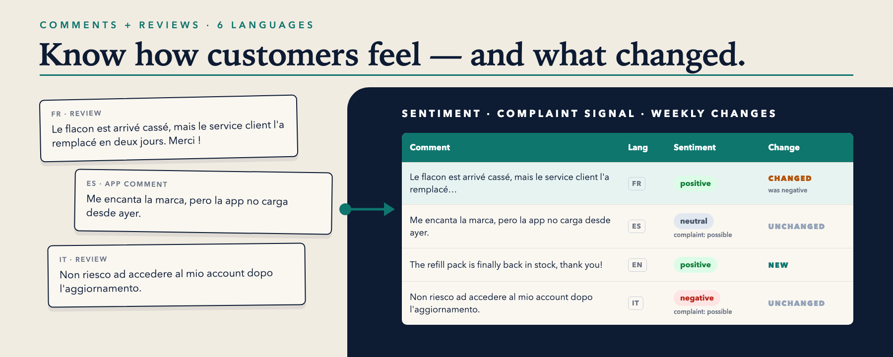

# Comment & Review Sentiment Analysis (6 Languages, No AI API)

<a href="https://apify.com/kazkn/social-media-sentiment-monitor?fpr=8fp2od">
  
</a>

**Comment & Review Sentiment Analysis** (also known as Social Media Sentiment Monitor) is an [Apify Actor](https://apify.com/kazkn/social-media-sentiment-monitor?fpr=8fp2od) that labels each comment or customer review as **positive**, **neutral**, or **negative**, detects its language, and flags duplicates and spam. It works in **English, French, German, Spanish, Italian, and Portuguese**, runs its sentiment models inside the Actor (no AI API), and can track what changed since the previous run.

This repository holds examples for the Actor: sample inputs, real sample outputs, and API snippets. The Actor itself runs on Apify.

**Try it:** [Run on Apify](https://apify.com/kazkn/social-media-sentiment-monitor?fpr=8fp2od) · [Demo video (2 min)](https://youtu.be/b5i8aiKIYtM)

## What it does

| You give it | You get, for each comment |
| --- | --- |
| Comments you paste, or the Dataset ID of any comments or reviews scraper run on Apify | `sentiment` (positive, neutral, negative) and a `confidence` score |
| An optional field name for the text, the ID, and the language | `language` (`en`, `fr`, `de`, `es`, `it`, `pt`, or `und` when too short to tell) |
| `mode: "monitor"` and a `stateKey` to compare runs | `status`: `NEW`, `CHANGED`, or `UNCHANGED` since the previous run |
| | `isDuplicate`, `isSpam`, and a beta `complaintSignal` for Spanish, Italian, and Portuguese |

Each run also writes a `SUMMARY` record with the sentiment split and net sentiment.

## Use cases

- **Customer review sentiment analysis** for e-commerce and app teams (app store reviews, Google Maps reviews, Trustpilot reviews, product reviews).
- **Comment sentiment analysis** for community managers (for example YouTube comments collected with a YouTube comments scraper).
- **Weekly brand sentiment monitoring** for marketing agencies: schedule the Actor and read only the comments that are new or changed.
- **Multilingual sentiment analysis** after a scraper, for data teams that need one label per comment in CSV, Excel, JSON, or through the API.

## Example

Input ([`examples/input-inline-comments.json`](examples/input-inline-comments.json), shortened):

```json
{
    "texts": [
        { "id": "en-1", "text": "Love the new serum, my skin feels amazing after two weeks." },
        { "id": "fr-2", "text": "Le flacon est arrivé cassé, très déçue." },
        { "id": "es-1", "text": "Me encanta la marca, pero la app no carga desde ayer." }
    ],
    "mode": "analyze"
}
```

Output from a real run ([`examples/output-sample.json`](examples/output-sample.json)):

| recordId | text | sentiment | confidence | language | complaintSignal |
| --- | --- | --- | --- | --- | --- |
| en-1 | Love the new serum, my skin feels amazing after two weeks. | positive | 0.9999 | en | not_evaluated |
| fr-2 | Le flacon est arrivé cassé, très déçue. | negative | 0.9972 | fr | not_evaluated |
| es-1 | Me encanta la marca, pero la app no carga desde ayer. | neutral | 0.8314 | es | possible |

The Spanish comment sounds polite, so its sentiment is neutral, but the complaint signal flags the app problem.

Summary of the full 15-comment run ([`examples/summary-sample.json`](examples/summary-sample.json)): 8 positive, 3 neutral, 4 negative, net sentiment +0.27.

## Run it from code

Python, with the [Apify client](https://docs.apify.com/api/client/python/):

```python
from apify_client import ApifyClient

client = ApifyClient("YOUR_APIFY_TOKEN")
run = client.actor("kazkn/social-media-sentiment-monitor").call(run_input={
    "texts": [{"id": "r1", "text": "Delivery took three weeks and nobody answered my emails."}],
})
for item in client.dataset(run["defaultDatasetId"]).iterate_items():
    print(item["recordId"], item["sentiment"], item["confidence"])
```

JavaScript, with the [Apify client](https://docs.apify.com/api/client/js/):

```js
import { ApifyClient } from 'apify-client';

const client = new ApifyClient({ token: 'YOUR_APIFY_TOKEN' });
const run = await client.actor('kazkn/social-media-sentiment-monitor').call({
    datasetId: 'YOUR_DATASET_ID', // the Dataset of any comments or reviews scraper run
    textField: 'text',
});
const { items } = await client.dataset(run.defaultDatasetId).listItems();
console.log(items.map((i) => `${i.recordId} ${i.sentiment}`));
```

For weekly tracking, use [`examples/input-dataset-weekly-monitor.json`](examples/input-dataset-weekly-monitor.json) with an Apify schedule.

## Accuracy

- Macro-F1 of 0.870 on 612 annotated test sentences (102 per language).
- Macro-F1 of 0.796 on real customer reviews translated into the six languages, and 0.672 on short extracts of 10 to 40 characters.
- Sarcasm, very short text, and indirect complaints are harder. Check a sample of your own data before automating decisions.

## Privacy

The sentiment models run inside the Actor: comments are never sent to an AI API. The monitoring memory stores only hashes, never raw text. No author profile is copied.

## Pricing

$1.50 per 1,000 analyzed comments, plus a small start fee. Invalid comments are not charged. See the [pricing page](https://apify.com/kazkn/social-media-sentiment-monitor/pricing?fpr=8fp2od).

## FAQ

**Does it scrape social networks?** No. It analyzes comments you already have, from another Actor's Dataset or pasted text.

**Is my text sent to an AI service?** No. The analysis and the models run inside the Actor.

**Which languages are supported?** English, French, German, Spanish, Italian, and Portuguese.

**Can I run it every week?** Yes. Use `monitor` mode with a stable `stateKey` and an Apify schedule.

## License

The examples in this repository are under the MIT License. The Actor is a paid Apify service.
